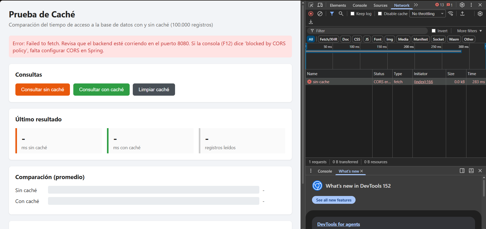
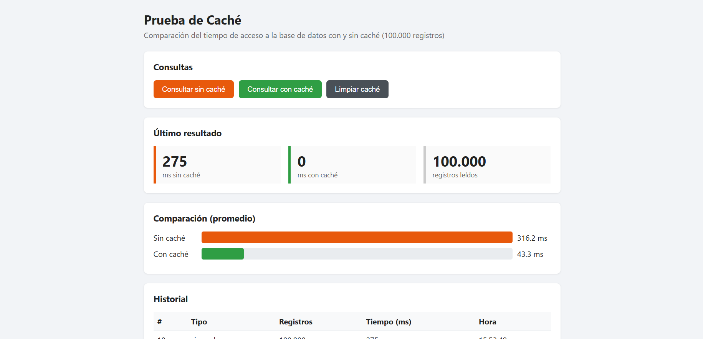

# Prueba de caché con Spring Boot

Aplicación en Java y Spring Boot que lee 100.000 registros de una base de datos H2 y compara el tiempo de respuesta con y sin caché.

## Tecnologías
- Java 21
- Spring Boot 4.1.1 (Web, Data JPA, Cache)
- H2 Database
- Front en HTML y JavaScript (Generado con IA)

## Como ejecutar
1. Ejecutar `CacheApplication` (backend en http://localhost:8080).
   La primera vez inserta 100.000 productos en prueba. 
2. Abrir `frontend/index.html` en otro puerto, por ejemplo:
   `npx http-server -p 5500` dentro de la carpeta frontend.

## Endpoints
- GET /api/productos/sin-cache
- GET /api/productos/con-cache
- GET /api/productos/limpiar-cache

## Resultados
| Consulta | Tiempo |
|---|---|
| Sin caché | ~280 ms (la primera ~590 ms) |
| Con caché, primera vez (miss) | ~700 ms |
| Con caché, siguientes (hit) | 0 - 1 ms |

En este caso podemos ver la diferencia de velocidad en el caso donde no tiene caché la primera vez se demora un total de  590ms y despues algunas veces mas llega a un promedio de 280ms, mientras que con el cache la primera vez se demora 700ms y las veces posteriores podemos ver que varia entre 0 y 1ms mostrando de esta manera la efiiencia de usar un cache. 

## Front generado con IA
El front fue generado con IA usando este prompt:

Genera un front en un solo archivo index.html con HTML, CSS y JavaScript puro (sin frameworks) que consuma mi API de Spring Boot en http://localhost:8080/api/productos.
Endpoints (todos GET):

/sin-cache → {"tipo": "sin cache", "registros": 100000, "tiempoMs": 280}
/con-cache → {"tipo": "con cache", "registros": 100000, "tiempoMs": 0}
/limpiar-cache → devuelve un texto

Quiero un botón para cada endpoint, que muestre el tiempo de cada consulta, un historial de las consultas en una tabla y una comparación visual (barras) entre sin caché y con caché. Si falla la petición, muestra el error.

